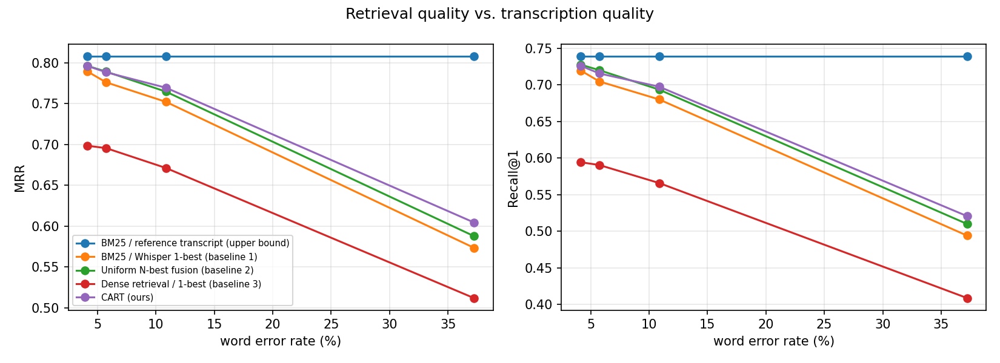
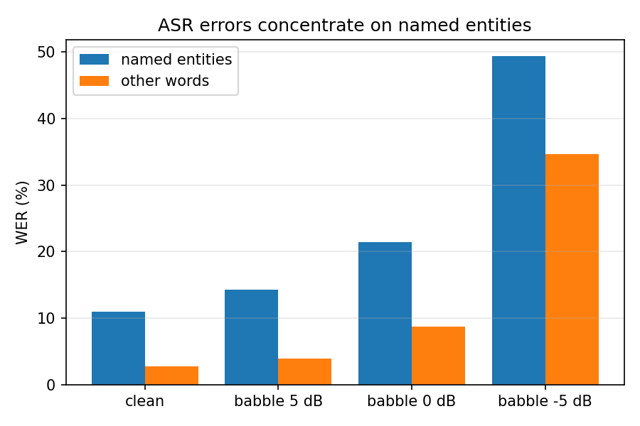
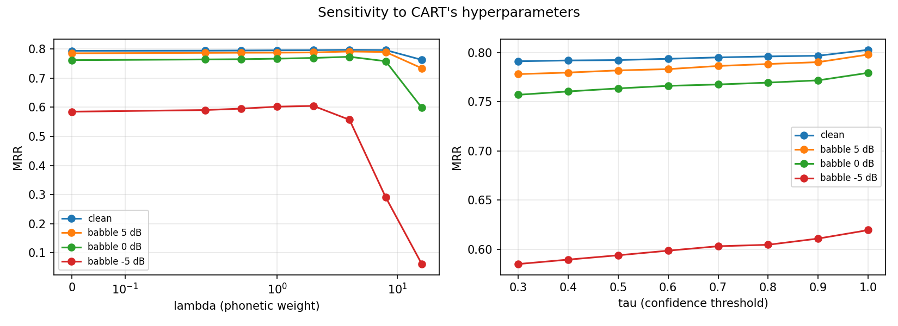

# CART: Confidence-Aware Retrieval for Audio RAG - experimental results

Recognizer: `faster-whisper small.en`, beam search with 8 beams. CART configuration (tuned on the dev split): tau=0.8, lambda=2.0, alpha=0.5, theta=0.55.

## 1. Transcription quality per condition

| condition | WER % | NE-WER % | non-NE WER % | words below tau % | conf AUC | low-conf words with an alternative % |
|---|---|---|---|---|---|---|
| clean | 4.2 | 11.0 | 2.8 | 9.1 | 0.848 | 19.8 |
| babble 5 dB | 5.7 | 14.3 | 4.0 | 11.4 | 0.831 | 21.4 |
| babble 0 dB | 10.9 | 21.5 | 8.7 | 17.3 | 0.827 | 26.1 |
| babble -5 dB | 37.2 | 49.4 | 34.7 | 49.4 | 0.772 | 22.4 |

## 2. Retrieval effectiveness (held-out test queries)

`*` = significantly better than BM25 / 1-best, `v` = significantly worse (two-sided paired bootstrap on reciprocal rank, 5000 resamples, p < 0.05; p values below 1/5000 = 2e-4 cannot be resolved by this test).

### clean  (WER 4.2%, n=4021 queries over 1896 passages)

| system | R@1 | R@5 | R@10 | nDCG@10 | MRR | MRR 95% CI | ms/query |
|---|---|---|---|---|---|---|---|
| BM25 / reference transcript (upper bound) | 0.7394 | 0.8985 | 0.9281 | 0.8376 | 0.8081* | [0.798, 0.818] | 0.06 |
| BM25 / Whisper 1-best (baseline 1) | 0.7197 | 0.8814 | 0.9142 | 0.8198 | 0.7892 | [0.778, 0.800] | 0.07 |
| Uniform N-best fusion (baseline 2) | 0.7277 | 0.8863 | 0.9184 | 0.8260 | 0.7961* | [0.785, 0.806] | 0.07 |
| Dense retrieval / 1-best (baseline 3) | 0.5944 | 0.8341 | 0.8993 | 0.7471 | 0.6984v | [0.687, 0.711] | 3.95 |
| CART (ours) | 0.7262 | 0.8876 | 0.9199 | 0.8263 | 0.7960* | [0.785, 0.806] | 41.60 |

### babble 5 dB  (WER 5.7%, n=4021 queries over 1896 passages)

| system | R@1 | R@5 | R@10 | nDCG@10 | MRR | MRR 95% CI | ms/query |
|---|---|---|---|---|---|---|---|
| BM25 / reference transcript (upper bound) | 0.7394 | 0.8985 | 0.9281 | 0.8376 | 0.8081* | [0.798, 0.818] | 0.06 |
| BM25 / Whisper 1-best (baseline 1) | 0.7048 | 0.8717 | 0.9048 | 0.8075 | 0.7760 | [0.765, 0.787] | 0.06 |
| Uniform N-best fusion (baseline 2) | 0.7202 | 0.8811 | 0.9135 | 0.8195 | 0.7891* | [0.778, 0.799] | 0.07 |
| Dense retrieval / 1-best (baseline 3) | 0.5906 | 0.8279 | 0.9000 | 0.7450 | 0.6955v | [0.684, 0.708] | 3.95 |
| CART (ours) | 0.7157 | 0.8841 | 0.9162 | 0.8196 | 0.7883* | [0.777, 0.798] | 42.96 |

### babble 0 dB  (WER 10.9%, n=4021 queries over 1896 passages)

| system | R@1 | R@5 | R@10 | nDCG@10 | MRR | MRR 95% CI | ms/query |
|---|---|---|---|---|---|---|---|
| BM25 / reference transcript (upper bound) | 0.7394 | 0.8985 | 0.9281 | 0.8376 | 0.8081* | [0.798, 0.818] | 0.06 |
| BM25 / Whisper 1-best (baseline 1) | 0.6802 | 0.8488 | 0.8866 | 0.7849 | 0.7521 | [0.740, 0.764] | 0.14 |
| Uniform N-best fusion (baseline 2) | 0.6936 | 0.8572 | 0.8968 | 0.7968 | 0.7646* | [0.753, 0.775] | 0.06 |
| Dense retrieval / 1-best (baseline 3) | 0.5660 | 0.8115 | 0.8759 | 0.7208 | 0.6712v | [0.658, 0.684] | 3.96 |
| CART (ours) | 0.6976 | 0.8645 | 0.9040 | 0.8022 | 0.7694* | [0.758, 0.780] | 61.86 |

### babble -5 dB  (WER 37.2%, n=4021 queries over 1896 passages)

| system | R@1 | R@5 | R@10 | nDCG@10 | MRR | MRR 95% CI | ms/query |
|---|---|---|---|---|---|---|---|
| BM25 / reference transcript (upper bound) | 0.7394 | 0.8985 | 0.9281 | 0.8376 | 0.8081* | [0.798, 0.818] | 0.06 |
| BM25 / Whisper 1-best (baseline 1) | 0.4942 | 0.6767 | 0.7364 | 0.6128 | 0.5736 | [0.559, 0.587] | 0.06 |
| Uniform N-best fusion (baseline 2) | 0.5101 | 0.6894 | 0.7498 | 0.6269 | 0.5879* | [0.574, 0.602] | 0.06 |
| Dense retrieval / 1-best (baseline 3) | 0.4089 | 0.6511 | 0.7463 | 0.5680 | 0.5121v | [0.499, 0.526] | 3.96 |
| CART (ours) | 0.5208 | 0.7147 | 0.7722 | 0.6451 | 0.6046* | [0.591, 0.618] | 81.90 |

## 3. Queries that mention a named entity

ASR errors concentrate on names, so this is where CART is supposed to pay off.

| condition | n (NE queries) | BM25 MRR | CART MRR | n (other) | BM25 MRR | CART MRR |
|---|---|---|---|---|---|---|
| clean | 2400 | 0.8290 | 0.8379 | 1621 | 0.7303 | 0.7339 |
| babble 5 dB | 2400 | 0.8131 | 0.8275 | 1621 | 0.7211 | 0.7302 |
| babble 0 dB | 2400 | 0.7841 | 0.8045 | 1621 | 0.7046 | 0.7175 |
| babble -5 dB | 2400 | 0.5941 | 0.6306 | 1621 | 0.5431 | 0.5662 |

## 4. Ablations

`*` = significantly better than full CART, `v` = significantly worse (two-sided paired bootstrap, p < 0.05). A variant marked `v` is one whose removed component was doing real work.

### clean

| variant | R@1 | MRR | ms/query |
|---|---|---|---|
| cart | 0.7262 | 0.7960 | 36.64 |
| -phonetic | 0.7249 | 0.7937v | 0.06 |
| -alt_index | 0.7207 | 0.7913v | 36.51 |
| -conf_gate | 0.6735 | 0.7511v | 36.53 |
| -conf_targeting | 0.7332 | 0.8027* | 106.66 |

### babble 5 dB

| variant | R@1 | MRR | ms/query |
|---|---|---|---|
| cart | 0.7157 | 0.7883 | 43.61 |
| -phonetic | 0.7152 | 0.7854v | 0.06 |
| -alt_index | 0.7055 | 0.7794v | 43.11 |
| -conf_gate | 0.6571 | 0.7337v | 43.04 |
| -conf_targeting | 0.7279 | 0.7979* | 107.15 |

### babble 0 dB

| variant | R@1 | MRR | ms/query |
|---|---|---|---|
| cart | 0.6976 | 0.7694 | 62.04 |
| -phonetic | 0.6899 | 0.7618v | 0.06 |
| -alt_index | 0.6879 | 0.7603v | 62.43 |
| -conf_gate | 0.6252 | 0.6996v | 62.10 |
| -conf_targeting | 0.7075 | 0.7793* | 109.66 |

### babble -5 dB

| variant | R@1 | MRR | ms/query |
|---|---|---|---|
| cart | 0.5208 | 0.6046 | 81.22 |
| -phonetic | 0.5058 | 0.5848v | 0.06 |
| -alt_index | 0.5116 | 0.5949v | 80.96 |
| -conf_gate | 0.3778 | 0.4639v | 81.12 |
| -conf_targeting | 0.5382 | 0.6195* | 92.82 |

## 5. Downstream question answering

Reader: `Qwen/Qwen2.5-1.5B-Instruct`, top-3 retrieved segments as context. `*` = significantly better than BM25 / 1-best on token-F1, `v` = significantly worse (two-sided paired bootstrap, p < 0.05).

### clean  (n=400)

| system | EM | token-F1 | F1 95% CI | LLM judge |
|---|---|---|---|---|
| BM25 / reference transcript (upper bound) | 0.5850 | 0.6632* | [0.619, 0.705] | 0.7100 |
| BM25 / Whisper 1-best (baseline 1) | 0.5300 | 0.6296 | [0.585, 0.672] | 0.6775 |
| Uniform N-best fusion (baseline 2) | 0.5275 | 0.6308 | [0.587, 0.672] | 0.6775 |
| CART (ours) | 0.5325 | 0.6330 | [0.589, 0.674] | 0.6825 |
| cart+altctx | 0.4875 | 0.5794v | [0.534, 0.624] | 0.6300 |

### babble 0 dB  (n=400)

| system | EM | token-F1 | F1 95% CI | LLM judge |
|---|---|---|---|---|
| BM25 / reference transcript (upper bound) | 0.5850 | 0.6632* | [0.619, 0.705] | 0.7100 |
| BM25 / Whisper 1-best (baseline 1) | 0.4700 | 0.5712 | [0.527, 0.614] | 0.6125 |
| Uniform N-best fusion (baseline 2) | 0.4750 | 0.5708 | [0.526, 0.614] | 0.6175 |
| CART (ours) | 0.4800 | 0.5785 | [0.535, 0.621] | 0.6275 |
| cart+altctx | 0.4350 | 0.5463 | [0.500, 0.589] | 0.5925 |

### babble -5 dB  (n=400)

| system | EM | token-F1 | F1 95% CI | LLM judge |
|---|---|---|---|---|
| BM25 / reference transcript (upper bound) | 0.5850 | 0.6632* | [0.619, 0.705] | 0.7100 |
| BM25 / Whisper 1-best (baseline 1) | 0.2525 | 0.3311 | [0.289, 0.373] | 0.3675 |
| Uniform N-best fusion (baseline 2) | 0.2475 | 0.3286 | [0.287, 0.371] | 0.3650 |
| CART (ours) | 0.2350 | 0.3212 | [0.282, 0.363] | 0.3575 |
| cart+altctx | 0.2200 | 0.2985v | [0.259, 0.340] | 0.3500 |

## 6. Index cost

| condition | system | vocabulary | postings | phonetic terms |
|---|---|---|---|---|
| clean | BM25 / Whisper 1-best (baseline 1) | 22588 | 153972 | 0 |
| clean | Uniform N-best fusion (baseline 2) | 26284 | 160284 | 0 |
| clean | CART (ours) | 25056 | 157923 | 10568 |
| babble 5 dB | BM25 / Whisper 1-best (baseline 1) | 22319 | 153705 | 0 |
| babble 5 dB | Uniform N-best fusion (baseline 2) | 26593 | 161457 | 0 |
| babble 5 dB | CART (ours) | 25356 | 159014 | 12761 |
| babble 0 dB | BM25 / Whisper 1-best (baseline 1) | 21972 | 152473 | 0 |
| babble 0 dB | Uniform N-best fusion (baseline 2) | 27392 | 164714 | 0 |
| babble 0 dB | CART (ours) | 26152 | 161576 | 17386 |
| babble -5 dB | BM25 / Whisper 1-best (baseline 1) | 17909 | 155185 | 0 |
| babble -5 dB | Uniform N-best fusion (baseline 2) | 22938 | 179486 | 0 |
| babble -5 dB | CART (ours) | 21991 | 173189 | 20071 |

## 7. Figures

